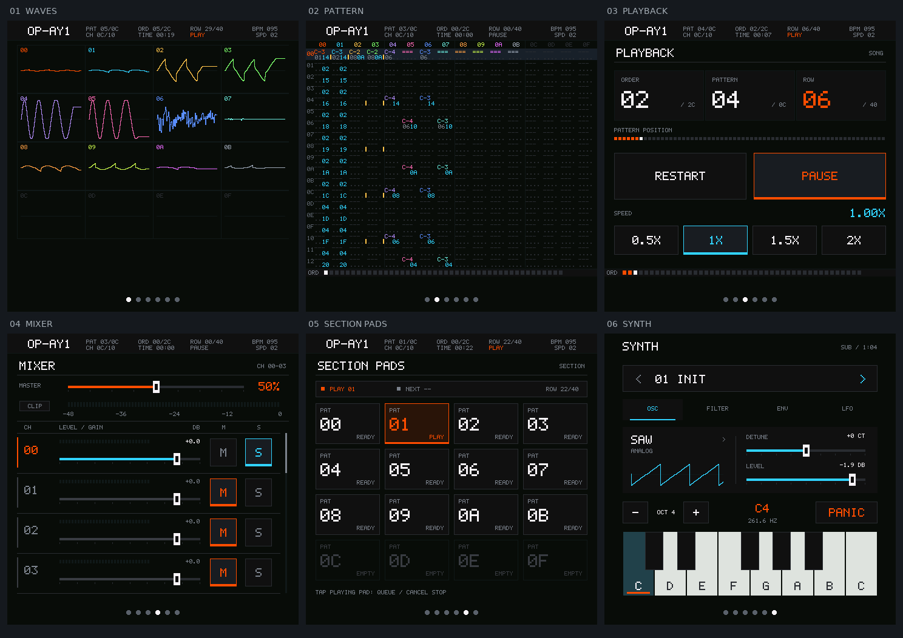
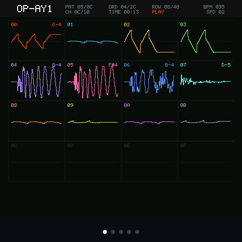
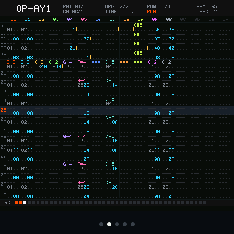
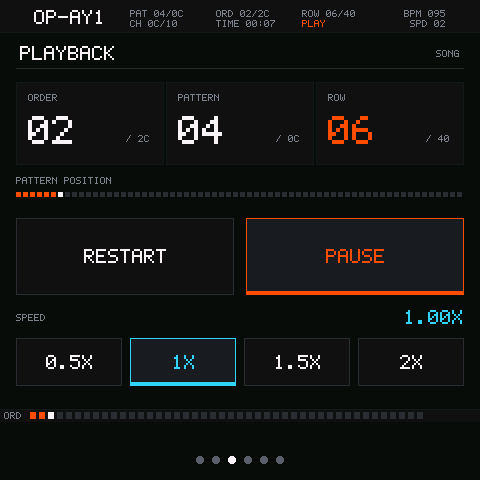
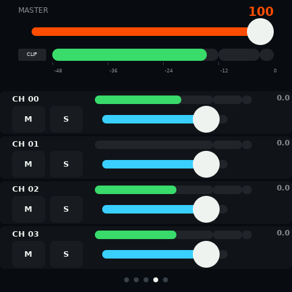
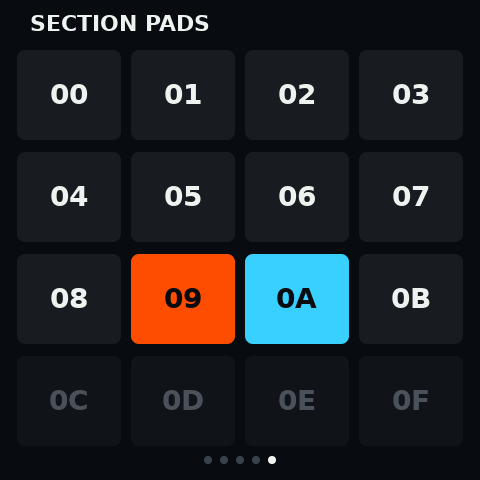
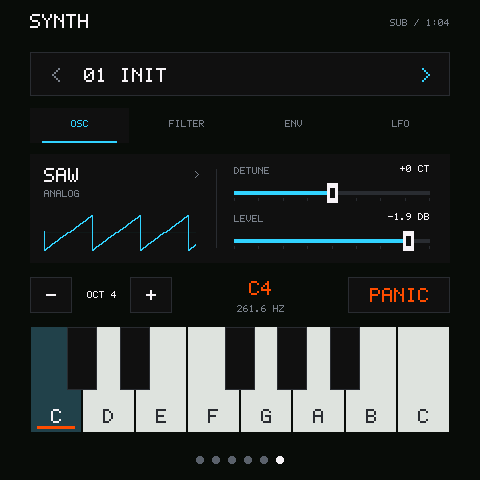

# OP-Ay1

A handheld tracker and music workstation for **ESP-Mosaico**: native synthesis,
S3M playback and a pixel UI on a 480×480 touch display.

The local `codex/project-build-tests` branch adds the approved 2×2 HOME
launcher, a shared project session with NAND save/load, and a sample editor with
WAV import and microphone recording. Portable regression tests, native GSP input
checks and the pinned ESP-IDF firmware build passed on 2026-10-27. Board NAND,
microphone capture and power-loss recovery still require hardware acceptance.
See the
[implementation record](docs/project-workstation-implementation.zh-CN.md) for
storage ownership, import paths and the pending verification boundary.

**Current source:** [main](https://github.com/AyalaKaguya/OP-Ay1/tree/main)
contains the six-page UI, four-voice synthesizer and display settings described
below. The existing
[v1.0.0 release](https://github.com/AyalaKaguya/OP-Ay1/releases/tag/v1.0.0)
is the earlier five-page tracker player; its downloadable firmware has not been replaced.



*Device captures · ESP-Mosaico · 2026-10-26. These are running firmware screenshots.*

## What it does

- **Four-voice synthesizer** — subtractive and built-in wavetable synthesis;
  saw, square, triangle and sine waves; a low-pass filter, ADSR and LFO per voice.
  INIT, BASS, LEAD and PAD presets can be edited while playing.
- **Touch performance** — hold a key, slide between notes and release into the
  envelope tail. Octave controls and PANIC stay within reach. Synth notes remain
  playable while the song is paused.
- **S3M player** — a portable C decoder, sequencer and mixer at 48 kHz stereo,
  with tempo/speed effects, sample loops, panning and per-channel gain.
- **Shared audio output** — tracker and synth mix through one floating-point bus;
  final saturation, master metering and clip detection happen at the output.
- **Mixer** — dB faders, dBFS meters, mute/solo and a scrollable channel list.
  The master volume controls the onboard codec separately from digital source gain.
- **Section Pads** — a 4×4 Pattern launcher with queued switches and stops at
  Pattern boundaries. The playing and upcoming patterns have distinct feedback.
- **Shared native UI** — device and GSP simulator run the same C interaction
  model and renderers. Scopes and Pattern view keep their original tracker look;
  Playback, Mixer and Pads now use the same bitmap font and grid.

Hardware: **ESP32-S31**, **CO5300 480×480 display**, **ES8311 audio** and
**CST9220 touch** on the ESP-Mosaico board.

## Six pages

| WAVES | PATTERN |
|---|---|
|  |  |

| PLAYBACK | MIXER |
|---|---|
|  |  |

| SECTION PADS | SYNTH |
|---|---|
|  |  |

The Mixer capture shows solo while the song is paused, so its meters are zero.
The Pad capture shows the state after a Pattern switch has completed.

## Controls

- **Navigation:** swipe horizontally outside captured controls to change pages;
  swipe up from the bottom edge to return HOME. Page dots briefly indicate the
  selected page after a horizontal swipe.
- **Playback:** play/pause is immediate; RESTART pauses and rewinds the song.
  Speed presets are 0.5×, 1×, 1.5× and 2×.
- **Mixer:** drag a fader horizontally; drag the list vertically to scroll.
  Use the right gutter to scroll without touching faders. Gain steps:
  100 = 0 dB, 120 = +6 dB, 50 = −15 dB, 0 = silent.
- **Section Pads:** tap a Pad to loop its Pattern; tap another to queue a switch.
  Tap the playing Pad to queue a stop, then tap again to cancel it.
- **Synth:** choose a preset and OSC / FILTER / ENV / LFO tab, adjust parameters,
  then hold or slide across the keyboard. PANIC clears voices. Edits stay in RAM.
- **AI button:** short press toggles song playback; long press pauses and rewinds.

Swipe down from the top edge to open Quick Settings for battery status,
brightness, automatic/manual rotation and USB MIDI Host / Vendor selection.
The [settings implementation record](docs/global-settings-plan.zh-CN.md)
tracks its own build and device acceptance separately from the earlier release.

The drawer includes independently configurable idle dimming and display-off
timers, both disabled by default. Pages slide and the drawer opens/closes with
short transitions. See the
[display timeout and animation record](docs/display-idle-motion.zh-CN.md).

## USB Host product exception

In this application's normal mode, MIDI IO temporarily assigns the S31 USB
controller to a class-compliant USB-MIDI 1.0 keyboard. Vendor restores the
ESP-Iris dual-CDC device used by the PC. Switching requires an on-screen
confirmation; PC USB disconnect is expected. Vendor is the default after reboot,
and USB role is not saved. OTG power is handled by the board hardware.

Iris UART0 control/log/RPC remains enabled on the board's default UART pins at
115200 baud. Use the product CLI and coordinate Gateway ownership for a UART
adapter; this build does not prove an attached UART cable or live TCP network.
Firmware delivery still requires Vendor USB's separate data link. Return to
Vendor on the device before reconnecting to the PC. The retained Vibe Mode
always uses Iris USB, with its partitions, identity and OTA writer unchanged.

## Build and preview

This repository is the application. Place it at `projects/OP-Ay1` inside an
ESP-Mosaico workspace with its pinned BSP and utility submodules initialized.
Activate the workspace's exact ESP-IDF checkout before building:

- Target: `esp32s31`.
- ESP-IDF: `7b9cc1ac79f865983f59bb8ff3ff43eb74ff1dbe`.
- ESP-GSP: `1.5.1`; GSPC: `0.6.1`.

This source also requires the workspace's ESP-Iris USB pause/resume integration,
validated with utils revision `f37a7d39447104e5e07f0fc2d6851c595c739c3e`
(workspace integration commit `ff623f5`). The earlier upstream utils revision
`be151ae` does not provide `esp_iris_usb_set_enabled()`; keep the integrated
utility checkout when building this version.

From the workspace root, select the current development source and use the
product CLI for installation and native preview:

```sh
git -C projects/OP-Ay1 switch main
python mosaico.py iris system-update --project projects/OP-Ay1
python mosaico.py project sim --project projects/OP-Ay1 --interactive
```

Installation uses retained **Vibe Mode** and an ESP-Iris `.irisfw` System Update
bundle. Native preview requires a host C compiler. For code-only updates,
`app-update` is available when the full partition table and resources match.

Run the portable checks from the application directory:

```sh
python tools/test_synth.py
python tools/test_audio.py
python tools/test_ui_renderer.py
python tools/test_ui_interaction.py
```

See the [UI and simulator contract](https://github.com/AyalaKaguya/OP-Ay1/blob/main/components/app_tracker/README.md)
and [device verification record](https://github.com/AyalaKaguya/OP-Ay1/blob/main/docs/implementation-validation.zh-CN.md)
for ownership, test coverage and evidence. Native regression tests, simulator
input checks and real-device installation/playback checks have passed; the
single-note synth level was increased by 6 dB after listening feedback.

## Limits and next steps

- Touch input currently supports one pointer. Four DSP voices do not imply
  independent multitouch chord input.
- Project persistence and sample recording/import are implemented on this local
  branch; their device paths still require hardware acceptance. A step sequencer
  remains future work. Section Pads launch Patterns rather than edit steps.
- USB MIDI Host device acceptance failed and further MIDI work is paused.
  Display timers and animations passed native/simulator checks and the pinned
  SDK build; physical display-off/wake and animation load remain unverified.
- The bundled song has 12 Patterns and 12 channels; Pad and mixer slots 0C–0F are empty.
- Long-duration maximum-load stability and browser focus-loss cancellation remain
  outside the completed checks. Occasional waveform-page timing spikes are
  documented in the verification record.
- External DAC output, physical faders and a keyboard matrix remain hardware goals.

## License

Application code is **Apache-2.0**; see [LICENSE](LICENSE). Dependencies keep
their own licenses.

**Bundled music:** `main/assets/aryx.s3m` is © 1995 Karsten Koch, all rights
reserved. ModArchive permits unmodified, unbundled redistribution; embedding
it in distributed firmware requires the author's written permission. See
[the licensing record](docs/store/licensing-aryx.md) for evidence and release constraints.
