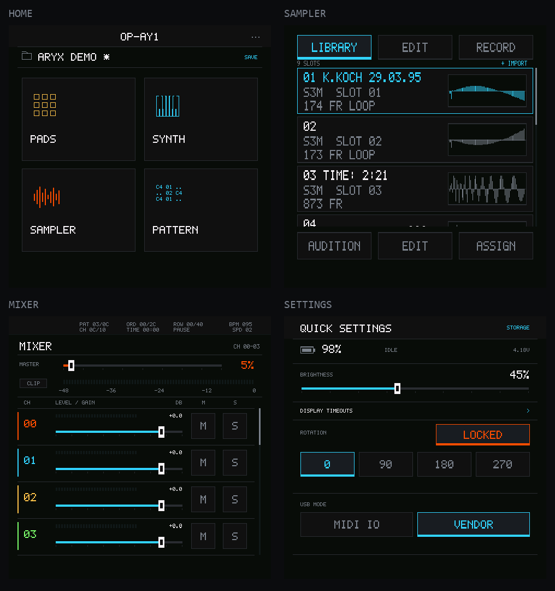

# OP-Ay1

[English](README.md) · [项目文档](docs/README.md)

基于 **ESP-Mosaico** 的掌上音乐工作站：在 480×480 触摸屏上播放 S3M、演奏四复音
合成器、管理工程，并通过板载麦克风或 WAV 文件创建采样。



*2026-10-27 真机截图。主屏、采样器、混音和设置共用同一个活动工程。*

## 创作与保存

- **NAND 工程存储**：新建空白工程或导入 S3M，保存完整会话并重新打开；另存为创建
  独立副本。工程包含原始模块、样本 PCM、合成器音色、混音参数和乐器槽映射。
- **采样器**：导入 WAV 或使用板载麦克风录音。大行列表支持上下滚动，每行右侧显示
  真实波形；支持试听、裁剪、循环、增益／C2 速率调整、Apply、Cancel 和 Undo，并可
  明确指定 tracker 乐器槽。录音监听默认关闭。
- **四复音合成器**：减法与内置波表合成，带低通滤波器、ADSR 和 LFO。可编辑 INIT、
  BASS、LEAD、PAD 音色，按住或滑动键盘演奏，不依赖歌曲播放状态。
- **S3M 播放**：原生 C 解码、音序与混音，48 kHz 立体声输出，支持速度／节拍效果、
  采样循环、声像和通道增益。
- **混音与 Pads**：可滚动的 dB 推子、电平、Mute／Solo 和独立 codec 主音量。
  4×4 Section Pads 启动 Pattern，在 Pattern 边界执行排队切换与停止。
- **共享界面**：设备固件与 GSP 原生模拟器运行相同的 C 控件与渲染代码。设备设置包括
  亮度、旋转，以及独立配置的闲置降亮度和息屏计时。

硬件：ESP-Mosaico 板，**ESP32-S31**、**CO5300 480×480 屏幕**、**ES8311 音频**、
**CST9220 触控**。

## 操作方式

HOME 使用三页 2×2 入口：第一页为工程、设置、播放和混音；第二页为 Pads、合成器、
采样器和 Pattern；第三页为 Waves。空白位置不可点击。

- **主屏左右滑动**切换入口页，页点短暂显示，不承担点击跳转。
- **从底边上滑**回主屏，模块向上退出；模块内部横向拖动只操作控件，不再切页。
- **只有主屏**显示工程名称、未保存标记和保存入口。导航保留当前会话，不重启歌曲。
- 顶边下滑打开快速设置。AI 按钮短按切换播放，长按暂停并回到开头。

采样列表行距是旧版的 1.6 倍，文字使用 2 倍位图字形。拖动滚动、短点选择；每行波形
替代了下方预览区和翻页按钮。EDIT 页继续提供完整波形编辑。

## 在 ESP-Mosaico 工作区运行

将应用放在工作区的 `projects/OP-Ay1`，初始化工作区固定版本的 BSP 和已集成的
utils／ESP-Iris 子模块。

- 目标：`esp32s31`。
- ESP-IDF 固定为 `7b9cc1ac79f865983f59bb8ff3ff43eb74ff1dbe`。
- ESP-GSP `1.5.1`、GSPC `0.6.1`；原生预览需要主机 C 编译器。

在工作区根目录运行共享 C 应用的交互预览：

```sh
uv run mosaico.py project sim --project projects/OP-Ay1 --interactive
```

使用工作区固定构建环境和设备操作流程，通过保留的 **Vibe Mode** 构建并安装：

```sh
uv run mosaico.py iris system-update --project projects/OP-Ay1
```

Vendor USB 提供 ESP-Iris 控制和数据链路，固件安装时保持 Vendor 模式。
MIDI Host 仍为实验功能，真机验收未通过，后续 MIDI 开发已暂停；见[设置记录](docs/global-settings-plan.zh-CN.md)。

## 验证与边界

截至 **2026-10-27**，最新界面已通过 5 套原生测试、27 项模拟器检查、固定 SDK 构建，
并在同一设备健康更新。真机已观察到 NAND 挂载、工程保存／重开，以及麦克风 Take
保存后跨固件更新重新读取。详情见[验证记录](docs/swipe-navigation.zh-CN.md)和
[组件契约](components/app_tracker/README.md)。

- 触控仅支持单指；四个 DSP 声部不代表多点触摸和弦。
- 物理掉电持久性、录音主观音质、长时间满负载及浏览器失焦时的输入释放仍待验证。
- Section Pads 用于启动 Pattern；步进音序编辑尚未实现。
- 启动时暂停播放。主音量属于工程，加载工程设置前初始值为 100%；调试使用的 5%
  不是永久设备偏好。

现有 [v1.0.0 Release](https://github.com/AyalaKaguya/OP-Ay1/releases/tag/v1.0.0)
是早期五页播放器，不包含本次工作站更新。

## 许可

应用代码采用 **Apache-2.0**，见 [LICENSE](LICENSE)；依赖保留各自许可。
**Aryx**（`main/assets/aryx.s3m`）版权归 Karsten Koch 所有，© 1995，保留所有权利。
尚未取得将其嵌入固件公开分发的授权，见[音乐授权记录](docs/store/licensing-aryx.md)。
