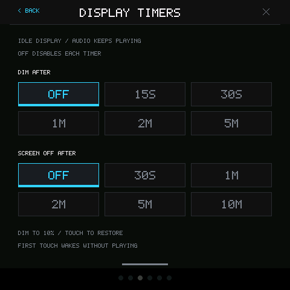

# 显示超时与界面动画

本次变更在 `codex/display-idle-motion`。MIDI 功能按用户要求暂停迭代，
此前外接键盘未连接／Vendor 返回问题保留，未宣称已修复。

## 设置与行为

从屏幕顶边下滑，在亮度下点击 **DISPLAY TIMEOUTS**：

- **DIM AFTER**：OFF、15 秒、30 秒、1 分钟、2 分钟、5 分钟。
- **SCREEN OFF AFTER**：OFF、30 秒、1 分钟、2 分钟、5 分钟、10 分钟。

两个定时器默认都为 **OFF**，分别从最后一次操作计时，保存在应用自己的 NVS 设置中。
旧设置缺少这些字段时继续关闭。降亮度输出为原亮度与 10% 的较小值，
恢复时使用用户的亮度偏好，既不覆盖亮度滑块值，也不把 10% 写成新的偏好。

降亮度后，触摸会恢复亮度并执行该操作。息屏后的第一次完整触摸手势只唤醒，
不会弹音符、换页或修改设置；第二次操作正常执行。按住控件／琴键期间保持亮屏。
AI 按键和合法的演奏操作也通知显示服务恢复，状态查询、电池／IMU 轮询和心跳不延长计时。
音频播放独立运行，不因显示超时暂停。

息屏使用 CO5300 的 Display Off / On 命令，不进入 Deep Standby，
不关闭触摸或长期暂停 GSP。设置 worker 只在短暂的显示栅栏内下发命令。
息屏后 UI 继续计时、触摸和心跳，抑制反复重绘，恢复成功后重新绘制。
硬件失败保留实际状态和错误，唤醒重试期间持续拦截误触。

## 动画与资源

换页为 200 毫秒横向滑动，底部导航保持固定；下拉菜单为 180 毫秒展开／收起。
使用整数缓出。连续点选导航从已经显示的合成画面重新开始，避免跳回旧页。
动画期间拦截底页新手势，既有手势仍完整接收释放。

UI 在启动时增加一张 480×480 RGB565 缓冲，约 450 KiB；设备使用既有 PSRAM 分配器。
页面和菜单动画共用该缓冲，逐帧合成不分配内存，沿用 50 毫秒 UI 定时器。
原生预览用同一 C 控制器与定时策略，并在预览图中模拟变暗／黑屏；
这不能代替真实面板命令、TE 同步、物理触摸唤醒和设备性能验收。

## 验证

方向、闲置策略、菜单 pointer、RGB565 动画边界和源缓冲测试已通过。
生产 worker 的故障注入覆盖旧 NVS 缺键、OFF 与输入竞争、命令失败／唤醒重试、
偏好持久化和从实际 OFF 停止后恢复面板。

实际 GSP 原生模拟器通过六页导航、菜单、动画中间帧／快速重定向，
以及真实等待 15 秒降亮度、30 秒息屏、DIM 首触直接演奏、OFF 首个完整手势只唤醒、
第二次触摸演奏。歌曲与音频帧数持续前进；累计捕获 4520960 帧立体声 PCM，
模拟器与 backend 均正常退出。截图逐张检查无裁切或越界。
证据在应用 `.codex-runs/idle-motion-sim/`，原生构建日志为
`.codex-runs/idle-motion-native-build.log`。

固定 SDK 最终构建 `20261027-005016-build-64400` 返回 OK，应用 1632608 字节，
runner 报告 1 项 warning。完整日志在
`.codex-runs/idf-low-noise-build/20261027-005016-build-64400/raw.log`。
这轮没有修改 MIDI 源码，也未将本轮显示／动画变更刷入设备；
真实 Display Off 的 TE 行为、物理唤醒和满负载动画性能仍需真机验收。
