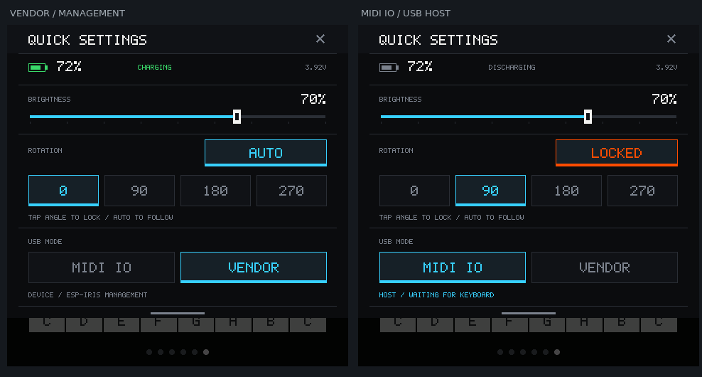

# 全局下滑菜单实施方案

日期：2026-10-26。分支：`codex/global-settings`。
状态：已实现、构建并刷入。用户已确认 AUTO 四方向和锁定正常；USB MIDI 实机测试未通过，按用户要求暂停迭代。

## 已确认的需求

- 所有页面可从屏幕顶部下滑打开菜单。
- 增加亮度滑块和四方向屏幕旋转；“锁定”指固定旋转方向。
- MIDI IO 指本机作为 USB Host，连接 USB MIDI 键盘，不是连接电脑的 MIDI Device。
- 提供 Vendor 管理模式和顶部电池状态。
- 按用户反馈移除 OTG 电源条目，菜单不显示供电开关或推测的供电状态。
- 延用现有像素字体、深色底、直角边框、青色选中和橙色状态反馈。

左图为 Vendor 管理 / 自动旋转，右图示意 MIDI Host / 90 度锁定。
电量、充放电、亮度和电压均为说明布局的示例值，不是本次实机读数。

## 能力核查

| 功能 | 已证实支持 | 实施边界 |
| --- | --- | --- |
| 亮度 | BSP `bsp_display_brightness_set`，CO5300 寄存器 0x51，0…100% | UI 建议限制 5…100%，避免持久化黑屏；后台合并连续拖动请求 |
| 四方向旋转 | Presenter 0/90/180/270 度和 physical→logical 触摸映射 | 独立显示任务暂停 GSP/等待传输 fence，改方向后恢复并全刷；不在 UI 回调等待自己 |
| 自动旋转 | BMI270 与 `bsp_imu_get_accel` 已存在 | 新增稳定驻留、滞回、平放/抖动保持、实机轴向校准；锁定后不再跟随重力 |
| 电池 | BQ27220，BSP 可读 SOC、电压、电流和状态位 | 约 1Hz 低频刷新，低电量突出显示；无效/过期数据标不可用，不伪装成实时值 |
| USB MIDI Host | S31 的 OTG/UTMI 支持 Host；官方 USB Host Library 支持该芯片 | 增加有界 MIDI 1.0 Streaming class client；需要真实键盘热插拔与音符验收 |
| Vendor 管理 | 现有 ESP-Iris 的控制/数据 CDC 链路 | Vendor 是产品模式名称；不是宣称已实现 USB 0xFF/WinUSB 类 |

此前同一真机日志识别为 v1.2。两版官方资料均描述了 Type-C 自动供电；
两版 CoreBoard 原理图第 5 页显示 HUSB320 的 PORT 浮空为 DRP，
ADDR/INT/SDA/SCL 没有连接 MCU，ID 输出直接控制 VBUS_EN。
SY7088 升压 EN 接共享 VCC_3V3，不能把 GPIO60 关闭系统电源轨当作独立 USB 电源开关。

来源：

- [ESP-Mosaico v1.2 官方指南](https://docs.espressif.com/projects/esp-dev-kits/en/latest/esp32s31/esp-mosaico/user_guide.html#hardware-notes)
- [ESP-Mosaico v1.0 官方指南](https://docs.espressif.com/projects/esp-dev-kits/en/latest/esp32s31/esp-mosaico/user_guide_v1.0.html#hardware-notes)
- [v1.2 CoreBoard 原理图](https://dl.espressif.com/AE/Mosaico/SCH_SCH_ESP-Mosaico_CoreBoard_V1_2_1_2026-09-24.pdf)
- [v1.0 CoreBoard 原理图](https://dl.espressif.com/AE/SCH_SCH_ESP-Mosaico_CoreBoard_V1_0_2026-08-18.pdf)
- [官方 USB Host Library 1.6.0](https://components.espressif.com/components/espressif/usb/versions/1.6.0/changelog?language=en)
- [S31 USB Host 生命周期](https://docs.espressif.com/projects/esp-usb/en/latest/esp32s31/usb_host.html)

源码边界以当前 BSP `5f88b91`、utils `be151ae`、ESP-GSP 1.5.1、
esp_display_present 1.1.2 和固定 IDF
`7b9cc1ac79f865983f59bb8ff3ff43eb74ff1dbe` 为准。
MCP 已检索组件并读取详情；USB Host Library 拟显式固定 `espressif/usb ==1.6.0`，
它要求 IDF >=5.5.3，支持 S31；不采用缺少 S31 支持的 1.3.0。
没有把 `esp_midi` 的 SF2/MIDI 文件能力当作 USB-MIDI Host 驱动。

## 菜单交互

1. 从逻辑屏幕顶部约 0…32px 起手，明确向下拖动才展开；页面内部的 Mixer 纵向滚动不触发。
2. 打开后菜单优先捕获输入；点击 X 或向上收起，不穿透到底层 Pad/键盘。
3. 菜单打开仅取消触摸演奏，S3M 和外部 MIDI 音符继续运行。
4. 顶部电池栏显示图标、百分比、充电/放电/已满/不可用状态和电压。
   充电依据仪表状态与电流，不用“Vendor 连接电脑”代替电池实测判断。
5. 角度键手动选方向并锁定；点击 AUTO 恢复重力自动旋转，LOCKED 表示当前方向冻结。
   平放、晃动、无效 IMU 读数和触摸手势进行中都不自动旋转。
6. 亮度、方向锁定保存在应用自己的设置命名空间，不改写 sysmeta、身份或配网凭据。

## USB 模式与恢复

S31 的一个 OTG/UTMI 控制器不能同时作为“键盘 Host”和“电脑的 Iris Device”。
MIDI IO 切换不是增加一个设备接口，必须完整交接 USB 角色和 PHY 所有权。

- 默认启动 Vendor，保持现有电脑调试和更新体验。
- MIDI IO 显示 Host、等待/已连接键盘和收发活动；切换时说明电脑 USB 管理链路会断开。
- 首轮支持一个标准 USB-MIDI 1.0 Streaming 外设；解析 class/interface/endpoint，
  严格限制描述符长度和端点/传输缓冲，不承诺所有厂商私有键盘或 MIDI 2.0。
- 外部 Note On/Off、velocity=0、Sustain、All Notes Off 等进入统一音符路由。
  路由区分触摸与 MIDI 来源/通道，避免切页或松开触摸键错误截断外部键盘持有的同音高。
- 有 MIDI OUT 端点时，本机演奏可发送；收到的输入不自动回送，避免反馈。
- 拔键盘、枚举失败、切模式时可靠释放 MIDI 来源音符。
- 返回 Vendor 先停止/取消 Host 传输、等待回调、释放客户端/设备/Host，再恢复 Iris USB；
  失败时回滚并报告实际状态，不让菜单显示切换成功而 USB 仍被旧 owner 占用。

公共工具/transport 生命周期能力由 utils 的 ESP-Iris owner 负责，
应用侧不访问其私有结构或直接抢占已安装的 TinyUSB。
现有 `esp_iris_stop/start` 会停止/启动所有 transport，不能用来假装 Host 期间仍保留 TCP。
实施时需增加公开的单 USB transport 暂停/恢复接口，并尊重 console/data 两个 user 和自动重连逻辑。
正常应用的 USB Host 例外需记录在集成文档，保留真实 UART 维护路径；
TCP 只有在网络接口实际建立后才算可用，不以 `TCP=y` 作为联网证据。
板端菜单随时可返回 Vendor；Vibe Mode、AI 开机入口、分区布局与 OTA writer 归属保持原契约。

Host teardown 还必须覆盖重启前 DMA/PHY 静止，不能把 Iris 的 DCD-only shutdown
处理当成 Host HCD 已停。设备操作仍只使用工作区 `mosaico.py`。

OTG 电源条目已移除。供电只作为外接键盘的硬件接入前提核查，
不在菜单中提供开关，也不推断正在输出 5V 的实时状态。

## 实施与验证顺序

| 阶段 | 修改范围 | 验证重点 |
| --- | --- | --- |
| 1. 菜单与平台接口 | 应用内拆出 settings 状态/绘制，接入顶部输入优先级 | 六页均可打开/收起；不误触 Mixer/Pad/键盘；音频不被菜单暂停 |
| 2. 显示与电池 | app_display 自持 presenter/显示 worker，BMI270/BQ27220 采样 | 四方向画面与触摸一致，锁定/滞回/平放；亮度失败回滚，电池错误/过期显示 |
| 3. USB 生命周期 | utils 公共暂停接口、应用 Host owner 和 MIDI client | 两方向切换、失败回滚、唯一 PHY owner、维护/恢复可达、拔线释音 |
| 4. 原生回归 | 共享设置逻辑、模拟器输入、MIDI 解析/持有状态/故障注入 | 真正 pointer 操作，不用直接写状态代替交互；畸形描述符、短包和队列满 |
| 5. 固定 SDK 构建与真机 | 先 doctor，再按产物选择更新方式 | 身份/Boot ID/SHA、四方向校准、键盘实际发声/释音、热插拔与音频负载 |

设置/UI 先在共用 C 模拟器验证；旋转、燃料计、USB 枚举/热插拔的真实行为需要设备检查。
没有 MIDI 键盘或合规转接线时，可完成协议和模拟器验证，但不能宣称键盘接入已验收。

## 实施与实机记录（2026-10-27）

共享 C 模拟器通过六页下滑、关闭不穿透、页面手势跨顶边保留所有权、亮度端点、
四角度/锁定请求、USB 确认/取消和原生 USB 不可用错误。打开菜单时歌曲和音频渲染继续。
原生预览不模拟实际面板旋转、传感器或外接键盘。

MIDI router/描述符/短包/队满及生产 Host 失败回滚测试通过，包含延迟完成的 Iris 暂停超时
自动恢复 Vendor、在途回调未归还时保留缓冲、恢复失败重试和稳定 Host 的重启静止处理。
Iris 公共 transport/runtime 通过 14 个控制/关闭组合与 56 个完整 runtime 配置组合。

固定 SDK 构建 `20261027-001727-build-29996` 返回 OK，应用 1626944 字节，
runner 报告 1 项 warning，完整日志保留在应用 `.codex-runs/idf-low-noise-build/`。
工作区与应用的源代码分别保留在 `codex/global-settings-integration` 和
`codex/global-settings` 分支，当前未推送这次新功能。

设备 `4553502d4952495301001c2904d088f4` 首次安装后读取到亮度 70%、电池 100%、
4173 mV、FULL、IMU 可用、display/USB error 均为 0。这是当时读数，不代表以后一直不变。
用户发现 AUTO 的 0°/180° 反向，已校正 Y 轴映射并更新方向回归；
用户随后确认四方向 AUTO 和锁定均正常。

修正版安装 operation 为 `019a346d-9732-48b5-8eb2-a0cd992a496c`，
正常应用 Boot `13092727238931166822` → Vibe Mode writer Boot
`12775062407870840203` → 正常应用 Boot `5790283613369077071`，
healthy=true。ELF SHA-256 为
`315220511c9493853fb1b42bbf0a58bbe993f22ef23927dbf9975e47426e9fee`。
bootloader 与完整分区表哈希保持原值；更新包没有写入身份、凭据或 Vibe Mode 分区。

工作区 `.codex-runs/global-settings-implementation/` 保留两个安装 receipt、
安装前日志/core dump 指引、原生故障证据归档和设备查询结果；
应用 `.codex-runs/settings-sim/` 保留真实 pointer 测试和模拟器截图。
USB 安装/切换与强制重启重叠仍未验收；计划重启须先完成 Vendor 交接。

用户随后反馈“键盘未连接，或回不了 Vendor”，该反馈未进一步拆分定位；
按用户要求暂不继续 MIDI 功能迭代。原生测试通过不代表 USB 键盘实机验收通过。
后续工作转为闲置降亮度、自动息屏设置和界面动画，默认两个超时均关闭。
