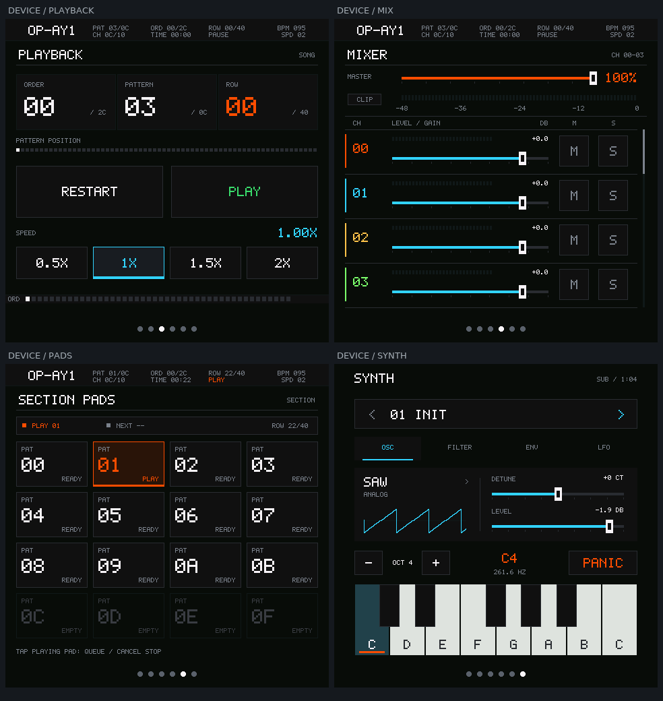

# 合成器与界面重构验证记录

日期：2026-10-26。分支：`codex/synthesizer`。

## 已实现

- 六页共用原生 C 界面：WAVES、PATTERN、PLAYBACK、MIXER、SECTION PADS、SYNTH。
- Playback、调音台和 Pad 使用已确认的像素字体、紧凑状态栏和直角网格。
  首两页保留原有绘制结果。
- 4 复音减法/内置波表引擎；锯齿/方波抗混叠、三角、正弦、波表位置插值；
  每声部低通、ADSR、LFO；INIT/BASS/LEAD/PAD；运行期参数编辑和单指滑奏。
- S3M 与 synth 浮点输出共用总线，在最终 int16 转换处饱和；主电平取最终数字总线。
- 音频初始化失败回滚、命令队满释音、页面切换取消、参数失败重试、跨任务硬件键请求。
- GSP 场景缩为一个 Canvas，设备/主机运行同一控制代码；旧生成文件改为 build 输出。
  原 `tracker_engine` 组件目录改为 `app_tracker_engine`，C API 保持兼容。

## 主机与模拟器

| 检查 | 结果 |
| --- | --- |
| 合成器 | A4 440Hz、ADSR、全部波形/LFO、极值、声部抢占、队满释放/紧急静音、并发生产者通过 |
| 分块一致 | 8193 帧不规则分块与整块逐字节一致；空闲改音色/动态声像/符号零通过 |
| 音频总线 | 提前裁剪、gain、clip、scope、瞬态峰值、暂停后 synth 继续演奏通过 |
| 初始化故障注入 | speaker/open/volume/unmute/两信号量/两任务共 8 阶段失败回滚与重试通过 |
| 绘制边界 | 全部 793 个 Mixer 滚动位置、header/footer、不完整字形、前后 canary 通过 |
| 首两页 | 真实曲目初始画面固定 hash 及 live scope scratch 边界通过；重构时新旧逐像素对比一致 |
| 共用输入模型 | 六页导航、Master 21 档、Gain 121 档、Mute/Solo、空通道、Pad 边界及全部 synth 参数通过 |
| 官方模拟器 | 实际 press/move/release 输入、六页截图、滑奏/离键/释音、混音/滚动/Pad 排队通过 |
| 公开预览命令 | `mosaico.py project sim --project projects/OP-Ay1 --headless --duration 3` 返回 0 |
| 质量检查 | 变更文件的 pre-commit 格式、语法、秘密扫描、组件规则通过 |

模拟器通过 `tools/test_ui_sim.py` 驱动真实输入，没有用 RPC 直接写产品状态。
`ui-sim-clean/result.json` 记录 simulator 与 backend 正常退出码均为 0，
捕获 676352 帧 48kHz stereo PCM。四个预设的独立 8 秒 WAV 已回读检查，均非静音。

DSP 热路径优化保持输出：S3M/总线旧新各 98,500,608 字节逐字节一致，
覆盖全部 12 个 Pattern、gain/mute/solo/transport/Pad/混音和异常增益；
synth 动态参数 trace 13,598,720 字节也完全一致。没有开启全局 fast-math。

## 构建与安装

- 实际 SDK：`C:/esp/op-ay1-pinned/esp-idf`，HEAD 严格为
  `7b9cc1ac79f865983f59bb8ff3ff43eb74ff1dbe`；子模块按对应 gitlink 独立还原。
  原 SDK 保留，未切换其 HEAD。
- doctor：Python 3.11.15、IDF 6.2.0、esp32s31 与 manifest 约束均通过。
- 构建用固定低噪声 runner，输出位于 `build-pinned/`。
  一条已知工具提示为未加载来源未加入信任名单的 Iris IDF 扩展；无应用编译警告。
- System Update 包只含 partition table、main_app 和 ui_apps，保留原分区布局、
  retained prefix 和 bootloader。未直接调用 ROM 写入工具。

第一轮真机安装：

| 项目 | 实证 |
| --- | --- |
| Device ID | `4553502d4952495301001c2904d088f4` |
| MAC | `1C:29:04:D0:88:F4` |
| 原 Vibe Mode Boot ID | `6360821244688471246` |
| 第一轮应用 Boot ID | `7194850572351252674` |
| 安装 operation ID | `83742bee-8b9b-4705-a0ad-9eadbc7bc37b` |
| 应用 ELF SHA-256 | `fa5713abe7a0925a5eba6d9bde68d0bfc55959b92a8e49a39fad3249d292056f` |
| 更新结果 | 同设备、不同 Boot ID、正常模式、目标 SHA 一致、healthy=true |

## 真机功能与性能边界

第一轮真机已用 `mosaico.py iris rpc` 的标准 pointer/v1 输入完成六页切换、
主音量 50%、gain 0/unity、Solo 级联/恢复、歌曲播放/重启、Pad 启动/待停/取消/
排队边界切换，以及 synth C4/D4 按住/滑奏/松开、4 个参数页、离键释放与 PANIC。
每张截图保留同一 Device ID 与 Boot ID 的元数据。没有以工作台网页截图替代设备图。

单声部按住时观察到 `voices=1`、source peak `0.055087`，松开后归零。
测试结束 live status 的内部可用堆为 170275 字节、内部最低可用堆 113348 字节，
PSRAM 可用 12330420 字节。`iris memory` 的 task-memory 服务返回不支持，
这些数值来自 live `device-status`，不能等同于任务级内存剖析。

第一轮日志有 91 个约 5 秒汇总周期，没有 codec 写入失败、UI stall 或 panic。
S3M 播放期间，WAVES 页附近出现最大 24751us 的块墙钟耗时；该计时包含锁等待、
抢占、中断与内存访问，不能直接当成纯 DSP CPU 时间。对应时段 synth voices=0。
因此随后进行了保持输出一致的热路径优化，并增加 ready-wait/late-block 诊断。
最终四声部与歌曲并行的目标测量另附在本记录末尾。

尚待明确的实机体验包括物理触摸、扬声器听感及长时间满负载稳定性，
不以源 PCM 非零或安装成功代替这些验收。

浏览器预览 1.5.1 的 pointerup/pointercancel 会释音；真实浏览器按住 2 秒后正常
松开已验证。浏览器没有 blur/visibilitychange/lostpointercapture handler，
失焦自动释音没有验收通过，不能据此声明该能力。

## 证据位置

- 应用 `.codex-runs/ui-sim-clean/`：模拟器截图、state NDJSON、PCM 和结果。
- 工作区 `.codex-runs/device-validation/`：更新记录、身份、每次输入/状态、设备截图、原日志。
- 工作区 `.codex-runs/device-validation/before.core`：安装前保留的有效旧 Core Dump。
  旧 ELF 不匹配，未把它归因于本轮固件。
- 应用 `.codex-runs/idf-low-noise-build/`：完整构建 raw/clean/result 日志。
- `build-pinned/OP-Ay1-system-update.irisfw`：可安装产物；`OP-Ay1.elf` 为对应符号。

证据为本机开发产物，未提交大日志、编译输出或 Core Dump。本文不表示已发布商店版本。

## 最终性能修正版

固定 SDK 低噪声构建 `20261026-204846-build-29828` 返回 `OK`，
产物 `OP-Ay1.bin` 为 1461968 字节，System Update 包为 902553 字节。
最终安装 operation：`b32f88f1-2673-4d92-921f-d8199939170d`。

同一设备经过正常应用 → Vibe Mode → 正常应用：

- 前应用 Boot ID：`7194850572351252674`。
- Vibe Mode writer Boot ID：`218674410082103719`。
- 最终应用 Boot ID：`17222012137329243679`。
- 最终 ELF SHA-256：`91b13390b9a7c2299a9400dcdccd32b5c8d6ddbc016f72d3df75e6287e653b04`。
- 更新结果 `validated=true`、`healthy=true`，bootloader 和 partition table SHA 均保持不变。

限时诊断使用 PAD 波表音色、C4/E4/G4/C5 四音、velocity 96/127、10 秒自动释放，
同时播放原 S3M 并停留 WAVES 页。读取到 `voices=4`、`playing=1`、source peak
`0.0966`，结束后归零，最终 Boot ID 保持不变。

22 个约 5 秒汇总周期中：

- 空载 DSP 平均约 509us；歌曲播放通常约 2.8–3.4ms。
- 包含四声部并行的周期平均约 3.8–4.8ms，已记录周期峰值约 4.8–5.4ms。
- 所有观察周期的最大块墙钟时间仍有 21.777ms；共有 33 个块超过单块 10.667ms。
  波形/显示并行时存在偶发等待，不能声称每块均满足纯 DSP 期限。
- 输出任务等待 ready PCM 的最大时间仅 3us；4 块缓冲在本次测试中保持供应。
  没有 codec 写入失败、UI stall、panic 或重启；这不等于直接测得 DMA 永不欠载。
- 最终内部可用堆 170155 字节、最低内部可用堆 113228 字节、PSRAM 可用 12329908 字节。

证据：工作区 `.codex-runs/device-performance/result.json`、`logs.ndjson`、
同目录截图和逐次 RPC/身份记录。测试窗口有限，未宣称长期满负载稳定性。
设备最终留在 SYNTH / PAD 预设，歌曲停止、所有声部释放、主音量 50%。
扬声器听感与物理触摸的用户确认仍单独保留。

## 听感反馈后的增益修正

用户随后确认真机有声音，但声音偏小。再次读取 live 状态和设备截图时，
MASTER 已为 100%，LEAD 的 LEVEL 已达 +3.5dB，故不能继续归因于先前测试所留的 50%。
codec 默认的 50% 实际映射为 -25dB；100% 对应 0dB，但单个合成声部还叠加了
原有 0.18 固定缩放、音色 gain、velocity、ADSR、滤波和声像衰减。

将固定声部缩放从 0.18 改为 0.36，提升 6.02dB，S3M 通道保持原增益。
新增音量回归覆盖四个预设、C3/C4/C5 单音与相应 C/E/G/B 四音和弦：

- 单音 velocity 0.8 的稳态 RMS 为 0.0626…0.1019，约 -24.1…-19.8dBFS。
- 满力度和弦各渲染 10 秒，最高峰 0.9586，全部 12 个测试组合无裁剪。
- 音高、ADSR、分块一致、动态参数/声像、极值、队满释音、并发、总线和初始化回归仍通过。
- 任意参数编辑和与 S3M 并行仍由最终总线计量/饱和，测试不保证所有组合永不超载。

固定 SDK 构建 `20261026-212155-build-61532` 返回 OK，应用 1461984 字节。
安装 operation 为 `da6328b6-1a2a-41b8-bd60-095386fef40e`，
新 Boot ID `11467187957280080375`，healthy=true，ELF SHA-256 为
`6c455bd021f09a4603af50a8c53046b3fe338e56a07d2eb9119e4e512be4192c`。
恢复用户原 LEAD、detune -100ct、LEVEL +3.5dB 和 MASTER 100%，
歌曲停止、无按住音符。证据保存在工作区 `.codex-runs/volume-adjustment/`。
用户已确认此前有声；提高后的主观音量留待再次试听。
