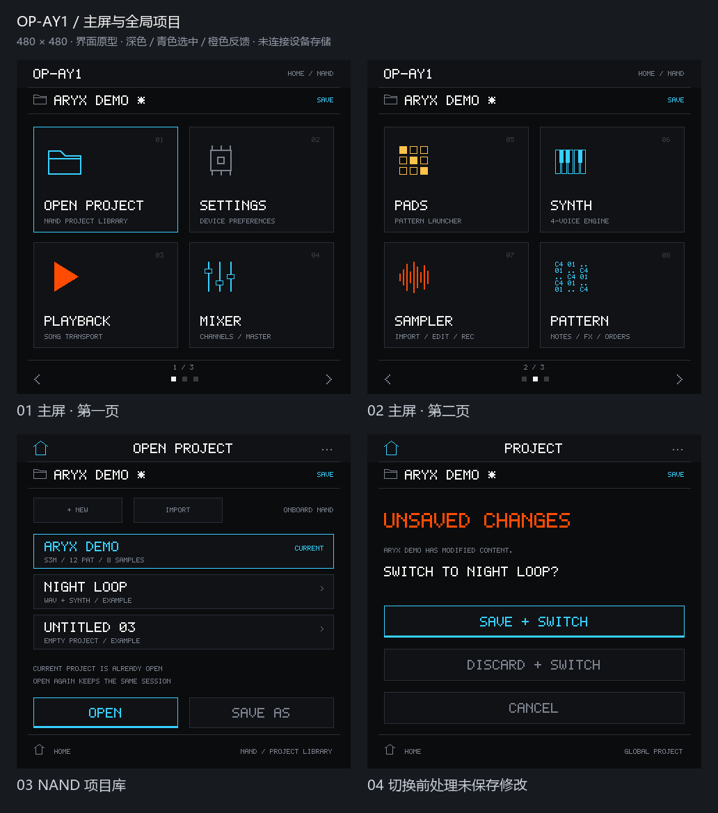
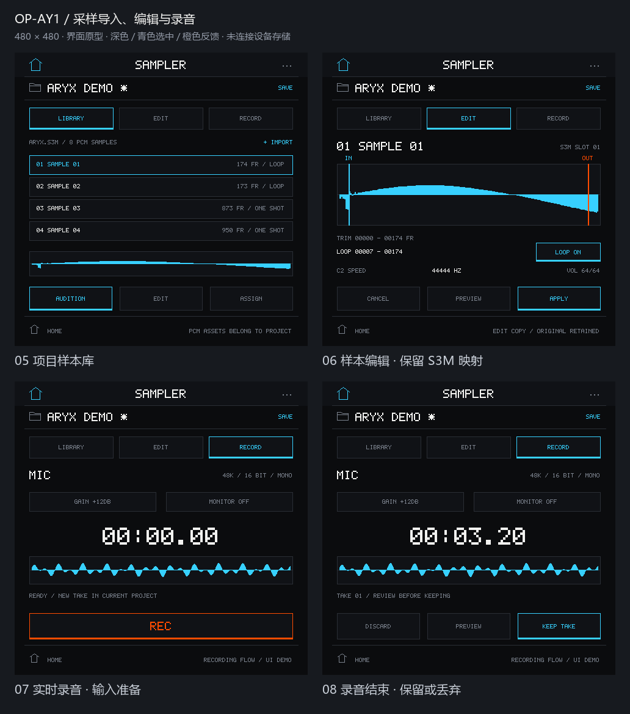

# 全局工程、HOME 与采样器原型规格

状态：**DESIGN ONLY / 设计原型**。本文件定义界面与操作含义，尚未实现工程存储、
采样导入／编辑或录音后端；演示数据与成功反馈不构成 NAND 或设备能力验收。
先展示完整原型，再确认整体布局与主要交互，之后实施生产代码。

[打开可点击原型](prototypes/project-system/index.html)。原型可离线打开，
包含 26 张 480×480 页面，使用当前生产 UI 的 5×7 字形与配色。
录音／保存都只改变浏览器内的演示状态，刷新即重置。

[导入、另存与失败流程总览](prototypes/project-system/project-workflow-overview.png)。

## 1. HOME 与模块导航

HOME 使用 2×2 网格，每页四个入口，顺序如下：

| 页 | 左上 | 右上 | 左下 | 右下 |
| --- | --- | --- | --- | --- |
| 1 | OPEN PROJECT | SETTINGS | PLAYBACK | MIXER |
| 2 | PADS | SYNTH | SAMPLER | PATTERN |
| 3 | WAVES | 空槽 | 空槽 | 空槽 |

空槽低对比、不可点，不假装存在未实现的应用。底部页码点与横向手势切换 HOME 页。
这些入口是同一工作站的模块，共用一个活动工程，不启动独立工程或音频实例。

顶部显示工程名、未保存 `*` 和保存入口；没有活动工程时显示 `NO PROJECT`。
模块保留统一 HOME 返回入口；已有的全局下拉设置继续可用。SETTINGS 与抽屉共用设置，
避免两套亮度、旋转或显示超时状态。回 HOME、换模块不重载工程、不停止歌曲或释放外部音符。
未打开工程时，演奏／编辑入口引导至“新建或打开工程”；SETTINGS 仍可使用。

## 2. 一个全局活动工程

活动工程包含名称、稳定 ID、内容版本、资源及各模块状态。顶部名称在所有模块一致。
打开当前工程只回到现有会话，不从磁盘重读，也不丢失未保存编辑。

工程浏览器包含 NAND 工程列表、最近打开、新建、导入 ARYX、另存为入口。
最近打开是已有工程的快捷入口；文件缺失或损坏时明确标记，不能显示为可用工程。
新建提供两个起点：**空白工程**与**从 ARYX 导入**，不擅自把示例当作所有新工程的内容。
未命名的新工程显示 `UNTITLED *`，首次保存时输入名称。

| 操作／状态 | 交互与结果 |
| --- | --- |
| SAVE | 保存当前工程的完整快照；保存中禁重复提交，完成后才清除 `*` |
| SAVE AS | 将当前内存快照保存为新 ID 的副本并激活，保留原工程；同名不覆盖 |
| 打开其他工程，当前无编辑 | 先验证并准备目标内容，成功后替换活动工程 |
| 打开／新建其他工程，当前有编辑 | 显示“保存并切换／放弃并切换／取消” |
| 保存并切换失败 | 保留当前工程、编辑及 `*`，不继续切换，显示可重试错误 |
| 放弃并切换时目标加载失败 | 保留原会话和编辑；仅在目标已准备成功时提交切换 |
| 取消 | 关闭对话框，工程与播放状态不变 |
| 成功切换工程 | 停止旧工程播放并释放旧工程音符，再激活目标；不自动播放新工程 |

加载、保存均有明确的进行中状态。失败不能把旧工程名提前换成目标名称，
也不能因一次文件写入成功就宣称整个工程已保存。

## 3. 保存范围与未保存标记

工程保存模块／Pattern 数据、原始效果信息、实际 PCM／录音资源、非破坏编辑参数、
音色 patch、混音参数、样本映射和工程编排状态。新录音与导入资源必须实际存入工程，
不能仅保存 PC 路径或临时缓存引用。内置 ARYX 亦保留原始模块数据与样本槽关系。

patch、增益／Mute／Solo、Pad 或乐器映射、编排和 Apply 后的样本编辑会产生 `*`。
只试听、触摸弹奏、播放位置、电平变化、当前查看页面不产生 `*`。
播放运行状态不随加载恢复。速度／循环等工程参数的持久化在实施时逐项列入格式契约。

亮度、旋转锁定、显示超时等设备偏好属于应用设置，不随工程另存或切换。
采样编辑的预览参数在 Apply 前不修改工程；Cancel 还原原值。

## 4. ARYX 导入与样本库

已检查的 `aryx.s3m` 为 20,800 字节，12 个 Pattern、每个 64 行、12 个通道；
Order 区有 44 字节，其中 42 项可播放；9 个乐器槽中 8 个含实际 PCM，1 个为空。
原型使用 `SAMPLE 01` 等中性编号，显示源槽号；没有证据时不命名为 Kick、Snare 等鼓件。

“从 ARYX 导入”创建新工程，保留原模块、Order、原始效果命令、乐器槽和 PCM 对应关系。
不能只提取音频却丢失原播放语义。空样本槽明确显示 EMPTY，不自动删除或重新编号。
导入不等于获得曲目授权，既有音乐版权及公开分发限制继续有效。

采样器的 LIBRARY 显示工程样本、来源、编号、长度及已解析的循环等信息；
未解析的单位或含义不补造。点样本查看，AUDITION 按明确的起止行为试听。
样本库与 Section Pads 分开：现有 PADS 是 Pattern 启动器，
样本只有经明确 ASSIGN 才建立映射，不能悄悄覆盖当前 Pad 或原 tracker 乐器。

## 5. SAMPLER：LIBRARY / EDIT / RECORD

| 标签 | 原型范围 |
| --- | --- |
| LIBRARY | 查看／试听工程样本，导入样本，进入编辑和明确映射流程 |
| EDIT | 波形预览、起止点、循环和增益等参数；试听副本，Apply 提交，Cancel 不改工程 |
| RECORD | 输入选择、待录、录制、停止、试听、保留或丢弃；真实后端未接入时标明演示 |

编辑采用“原资源＋编辑参数”或资源副本，不原地破坏 ARYX 内置文件。
Apply 才产生编辑版本和未保存标记；用户可回到原资源，至少保留本轮撤销入口。
替换 tracker 乐器必须另行明确确认其目标槽，保留槽编号和已有效果／映射关系。

导入区分“模块内样本导入”与“外部音频文件导入”。外部来源、支持格式、声道、
采样率转换和容量上限均待后端定义；未接入的 PC／USB 文件通道不能画成已经可用。
格式不支持或数据损坏时说明原因，原工程保持不变。

板载麦克风及 BSP 音频输入能力存在，但当前应用没有录音采集／保存路径。
原型不得把输入波形、时长、录音电平或“保存成功”冒充真实设备结果。
RECORD 展示的状态流为：待录 → 录制中 → 停止／试听 → KEEP 或 DISCARD。
KEEP 将实际采集资源加入当前工程并产生 `*`；没有采集数据时不能成功。
监听、边播边录、录音声道／采样率、丢帧与输入权限反馈需要独立验证。

## 6. NAND 存储与失败状态

建议应用独立命名空间：`/nand/apps/op-ay1/projects/<id>`。
这是待实施的挂载／目录方案，不代表应用已经能访问该路径。
目前正常应用没有 NAND 工程文件系统挂载；已有文件服务能力在 Vibe Mode，
不能据此推断正常应用已具备相同读写路径。不得格式化或复用身份／系统数据分区。

保存先写临时版本，核对清单、资源长度及完整性，再提交可见版本；
保留上次有效工程直到新版本提交完成。掉电或中途失败不能留下“成功”的残缺工程。
具体提交机制必须按选定文件系统的实际原子性与同步能力实现并测试。

| 情况 | 界面行为 |
| --- | --- |
| NAND 未就绪／挂载失败 | 显示存储不可用；不自动格式化，不伪装保存至 NAND |
| 容量尚未取得 | 显示 `容量未知`，不显示猜测的剩余 MB |
| NoSpace／配额不足 | 保留内存编辑与 `*`，说明无法完成保存；不删除其他工程腾空间 |
| 权限／只读／I/O 错误 | 显示具体类别与重试入口，保留上次有效版本 |
| 工程损坏／版本不支持／资源缺失 | 禁止替换活动工程，提供错误说明；不补造缺失样本 |
| 临时版本或中断保存 | 不作为正常项目自动打开，后端可验证后再提供恢复选项 |

## 7. 原型交付与后续验收

先展示 HOME 三页、项目浏览器、未保存切换对话框、保存／错误状态和采样器三标签。
原型交互覆盖：新建两种起点、重开当前工程、另存副本、取消／失败后保留编辑，
以及样本试听、Apply／Cancel 和录音演示边界。该阶段不写实际工程或设备存储。

生产实施另行验证：NAND 命名空间与不格式化挂载、掉电安全提交、完整工程往返、
资源自包含、ARYX 原效果／槽关系保留、录音真实数据与容量处理。
真实录音、存储、MIDI 或满负载表现均不能由静态原型代替验收。
