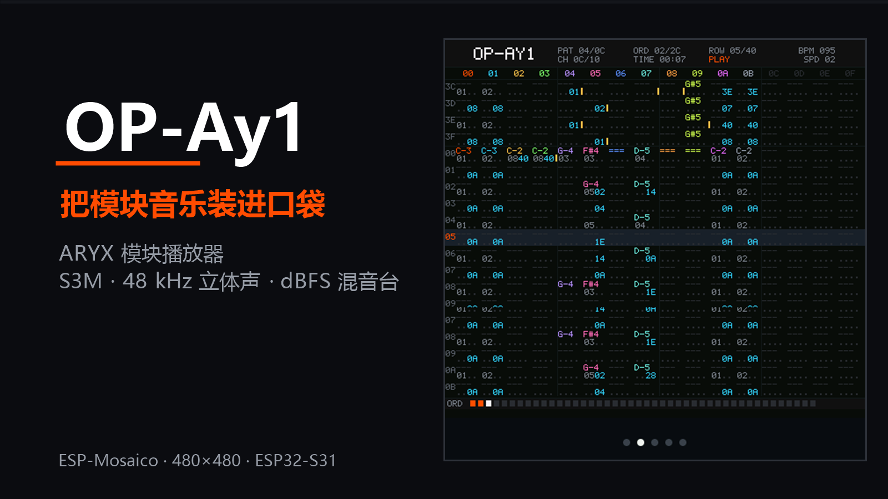
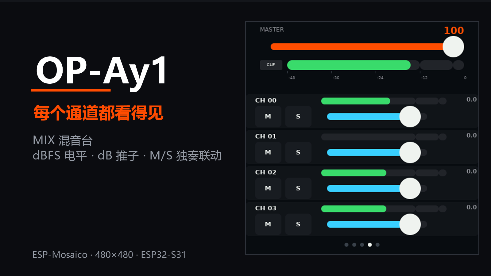
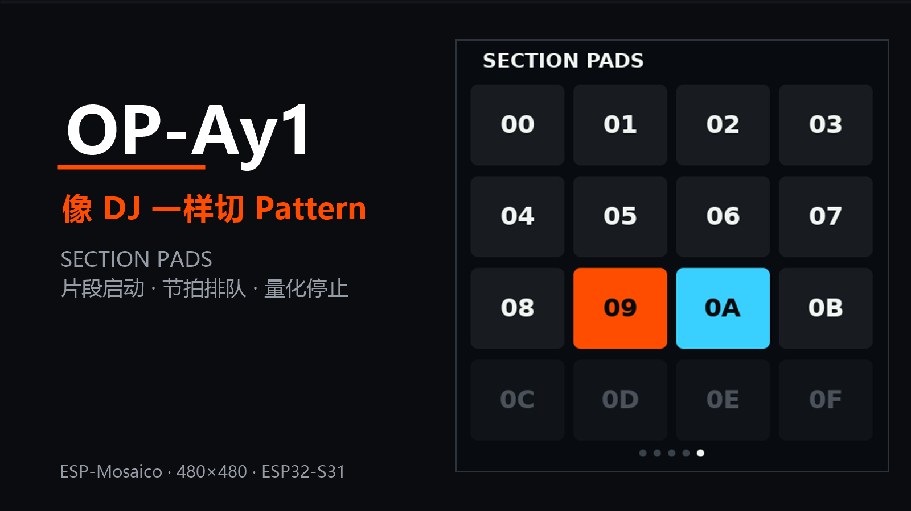

# OP-Ay1｜ARYX 模块播放器

> 把模块音乐装进口袋。

OP-Ay1 是一台围绕一首内置模块音乐 **ARYX（`aryx.s3m`）** 打造的掌上播放器。
它把谱面、波形、电平、混音和片段试听全部放进一块 480×480 的屏幕里：
插上电就能听，戴上耳机就能调，想看谱面时它又像一台小型 tracker。

## 首版能做什么

- **播放内置 ARYX 模块**：便携 C 解码 / 音序 / 混音引擎，48 kHz 立体声输出。
- **五种工作视图**：WAVES 波形、PATTERN 谱面、PLAYBACK 走带、MIX 混音台、
  SECTION PADS 片段启动器。
- **看得见的电平**：每通道峰值表 + 2K 采样波形 + 主输出 dBFS 电平与削波指示。
- **能调的混音台**：dB 刻度推子（0 dB / +6 dB / −15 dB / 静音）、M/S 独奏联动、
  可滚动的通道列表。
- **像 DJ 一样切 Pattern**：4×4 Section Pads，排队切换跟随节拍闪烁、在 Pattern
  边界接管；播放中再次点击当前 Pad 会在本段播完后量化停止。
- **稳定优先**：优先级继承的引擎互斥锁、UI 卡死看门狗、任务看门狗、更大中断栈，
  崩溃前日志保留在设备上，可随时取回。

## 怎么玩

- **播放 / 暂停**：PLAYBACK 页的播放键，或机身 AI 键短按。
- **回到开头**：PLAYBACK 页的 RESTART，或 AI 键长按。
- **变速**：PLAYBACK 页可选 0.5× / 1× / 1.5× / 2×。
- **调音**：MIX 页上下拖动列表滚动（从右侧空白处起手，避免误触推子）；
  左右拖动推子调增益，点 M / S 静音或独奏。
- **切段**：SECTION PADS 页点一个 Pad 循环播放该 Pattern；点另一个会排队，
  青色闪烁后在本段结束时切换；再点正在播放的 Pad 即排队停止（橙色闪烁）。

| MIX 混音台 | SECTION PADS 片段启动器 |
|---|---|
|  |  |

## 技术规格

- 硬件：ESP-Mosaico（ESP32-S31，480×480 CO5300 屏，ES8311 音频，CST9220 触控）
- 音频：48 kHz / 立体声，S3M（ProTracker）模块：12 Pattern、12 通道
- 引擎：纯 C 解码 / 音序 / 混音，可脱离 ESP-IDF 编译；设备上使用任务级互斥锁
- 界面：单 GSP 场景 + 设备端 canvas 渲染（波形 / 谱面 / 混音台）

## 路线图

**软件**

- [ ] 合成器：在模块播放之外加入原生减法 / 波表声部（滤波器、包络、LFO）
- [ ] 采样器：录音 / 导入、切片、映射到 Section Pads
- [ ] 音序器：Step / Clip 编曲、Pattern 串联与完整 Song 模式
- [ ] 扩展模块与轨道上限，加入 USB MIDI 输入

**硬件**

- [ ] 外置 I2S DAC，获得比板载 codec 更高的输出质量
- [ ] 物理推子，直接驱动 MIX 页
- [ ] 键盘 / Pad 矩阵，用于音符输入与演奏

> 首版只交付播放器与监听 / 混音能力；合成器、采样器与音序器按上面的顺序迭代。

## 兼容性与已知限制

- 需要 ESP-Mosaico 硬件与保留的 Recovery 固件；通过 ESP-Iris 安装。
- 内置曲目只有 12 Pattern / 12 通道：Section Pads 的 `0C`–`0F` 为空，MIX 的
  `0C`–`0F` 行为空槽。
- MIX 列表内横向滑动会翻页，纵向拖动才是滚动。
- 旧版 order 列表编辑器已被 Section Pads 取代。

## 许可与致谢

- 应用代码：Apache-2.0（见仓库 `LICENSE`）。
- 内置曲目 `aryx.s3m`：**授权信息待作者确认后补充**。
- 依赖：ESP-IDF、ESP-GSP、BSP、ESP-Iris 等保留各自许可，本仓库不内置其源码。

---

*截图均来自 ESP-Mosaico 实机，480×480。*
