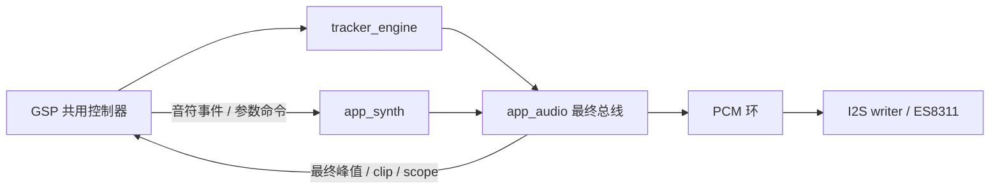
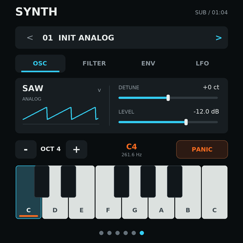

# OP-Ay1 合成器实施方案

日期：2026-10-26。依据：README 的 Synthesizer 路线图。
状态：用户已确认方案，合成器及三页重设计已经实现；原生模拟器和主机回归已通过，
固定 SDK 固件构建通过。设备检查单独列在 [验证记录](implementation-validation.zh-CN.md)。

## 现状与约束

| 位置 | 当前责任 | 合成器接入方式 |
| --- | --- | --- |
| `main/main.c` | 初始化服务，创建并连接引擎、音频、显示和界面 | 创建 synth 实例并连接依赖，保持入口精简 |
| `components/app_tracker_engine/` | 可移植 C 的 S3M 解码、音序、采样混音、监听 | 保留既有 C 接口，增加未裁剪浮点混音出口 |
| `components/app_audio/` | DSP 任务、PCM 环、I2S writer、codec 音量 | 持有最终总线，调度两个音源、混音、饱和转换和总输出计量 |
| `components/app_tracker/` | 五页 GSP 场景、控制器、canvas 绘制 | 增加 SYNTH 页及独立控制模块，接入原有导航 |
| `components/app_display/` | 480×480 RGB565 显示和触摸适配 | 继续复用，首轮不改 BSP |
| `submodule/esp-mosaico-utils/` | GSP 工具、模拟器、Vibe Mode 与安装契约 | 使用既有工具，不复制其实现 |

目前输出为 48 kHz、16 位立体声；每块 512 帧，期限约 10.67 ms。
PCM 环为 4 块，容量约 42.67 ms，实际按键到声音的延迟还受触摸轮询、
预渲染深度和 codec/DMA 缓冲影响，必须测量后判断是否需要缩短缓冲。

`tracker_ui.c` 已有约 1200 行，继续把 synth 状态和事件全塞进去不合适。
新增代码按 DSP、控制、绘制和平台适配拆分。

模拟器缺口：当前 app_tracker 没有 `host/` 或 `pc/` 后端，且直接依赖
FreeRTOS、ESP 定时器、PSRAM 和 BSP。需要抽出有限的平台接口并补
`host/CMakeLists.txt`，让模拟器执行设备共用的控制代码。
仅运行 scene-only 不能验证音符按下、松开或参数回调。

输入限制：GSP 当前公开 pointer 路径不能直接证明独立多指音符输入。
首版建议承诺单指键盘和滑奏；引擎的复音能力单独测试，不等同于触屏多指和弦。

初次构建检查：原 `build/project_description.json` 指向 `C:/esp/master/esp-idf`，
当前实际 HEAD 为 `383dda6c182e3dabf6355160166fe007df775629`，与工作区要求的
`7b9cc1ac79f865983f59bb8ff3ff43eb74ff1dbe` 不一致。该固定提交已存在于本地 Git
对象库。现已准备 `C:/esp/op-ay1-pinned/esp-idf`，核对子模块并通过 doctor。
新产物位于 `build-pinned/`，保留原 SDK 和原构建目录。

## 推荐首轮范围

- 4 个复音声部，固定 48 kHz，声部抢占顺序明确，先使用释放中/较早的声部。
- 减法合成：锯齿、方波、三角和正弦；锯齿/方波采用适合实时运行的抗混叠处理。
- 内置波表：少量程序生成的周期波表，支持波形插值与位置参数；本轮不做用户导入。
- 每声部低通滤波器、音量 ADSR、LFO；LFO 目的地提供音高/截止频率/音量。
- 参数限制合法范围，平滑连续参数；处理高共振、极短包络、重复音和快速抢占。
- 内置 INIT、BASS、LEAD、PAD 音色，运行期可编辑；首轮不增加音色保存格式。
- 独立 synth 与 S3M 可同时发声，分别调电平，共用最终总线和输出设备。
- 第六页 SYNTH，单指键盘/滑奏，八度切换，OSC/FILTER/ENV/LFO 分组编辑。
- 提供紧急静音 PANIC；切页、失焦、取消触摸时释放所有按住音符，防止长鸣。

采样录入、切片、音序器、把 synth 接成 tracker 乐器、USB MIDI、物理键盘
和外置 DAC 不属于此轮；它们在路线图中各有后续阶段。

## 责任与数据流

新增 `components/app_synth/` 只负责可移植 C 引擎，不依赖 GSP、BSP 或 codec。
UI 控制和绘制放在 app_tracker 下独立文件，由现有场景控制器统一分发事件。
主机与设备运行同一份 DSP 和主要交互逻辑，平台适配只承接时钟、分配和硬件按钮。

DSP 任务独占可变 voice 状态；UI 经有界命令通道提交音符和参数。
参数在渲染边界应用，连续参数在音频域平滑。明确队列满时的退化策略，
确保 Note Off 和 PANIC 不会因丢弃命令而留下持续发声。
渲染热路径不做堆分配，不在任务栈上放大型 PCM/voice 数组。

总线使用有余量的累加，再一次转换到 int16；保留 tracker 原有调用兼容性，
避免将两个已经裁剪的信号直接相加。MIX 的主电平/clip 改读最终输出，
tracker 通道表仍反映各 tracker 通道。合成器暂停/无按键时不阻塞 S3M。

音频初始化需要可回滚：处理任务或信号量创建失败、codec 配置失败和重试；
顺带修正当前 DSP/Writer 对统计字段的无同步读写，避免新增链路延续这些问题。

## 实施顺序与验收

| 阶段 | 交付 | 验证 |
| --- | --- | --- |
| 0. 方案与基线 | 确认下述产品选择，独立任务分支，固定 SDK 和 doctor | 仓库状态、真实 SDK SHA、目标 esp32s31、依赖版本 |
| 1. 可移植引擎 | 振荡器、4 voice、包络、滤波、LFO、内置波表、预设、事件契约 | A4 频率、包络时长/归零、分块等价、抢占、极端参数、队列满后释放、WAV 试听 |
| 2. 音频总线 | 并行音源、各自增益、最终计量和饱和转换、错误回滚 | 暂停/独奏/并行、过载边界、失败注入、tracker 回归 |
| 3. 共用 UI 与模拟器 | 第六页、键盘、滑奏、参数分组、预设、三页重设计、主机后端 | 真实 press/move/release/cancel、切页释音、滑奏不翻页、参数/预设更新、播放/混音/Pad 回归、截图检查 |
| 4. 固件构建 | 固定 SDK 下增量构建、GSP 资源重编译、安装包 | 低噪声 runner 成功、日志/警告/产物，保留分区布局与 Vibe Mode 契约 |
| 5. 实机验收 | 在设备交付阶段通过 mosaico.py 安装、演奏并测量 | 身份/版本、真实发声、最大负载 DSP 耗时、欠载、栈/内存、触摸延迟、恢复可达 |

主机与模拟器验证完成后才能进入对应设备检查；主机耗时不能证明 ESP32-S31 的实时性。
需要持续测量“最大复音 + S3M 播放 + 参数拖动/波形更新”的最差渲染时间，
与 10.67 ms 块期限比较并保留余量。若设备阶段未执行，单独列出尚未验证的项目。

## 页面提案与待确认点

这是 480×480 的设计草图，示例状态为按住 C4，不是已运行界面的截图。
沿用现有黑底、灰色卡片、青色选中和橙色演奏反馈。
页首显示预设和声部状态；中部按分组编辑参数；下部固定一组音符键和八度/PANIC。
键盘和参数区捕获拖动，页首/底部导航区域保留横向翻页。

已按用户确认的推荐基线实施：

1. 独立 synth 与 S3M 同时混音，共用输出和最终计量。
2. 减法 + 内置波表、4 复音、4 预设、每声部滤波/ADSR/LFO。
3. 第六页单指键盘/滑奏及分组参数；Playback、调音台和 Pad 采用像素网格设计。

建议 transport 仍只控制 S3M；暂停歌曲后仍可弹 synth，硬件 AI 键继续控制歌曲。
PANIC 负责清空 synth 发声，触摸松开走 ADSR Release。
如果需要全局 transport 同时停止所有音源，应在确认时一并说明。
