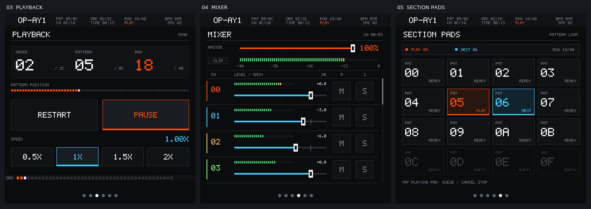
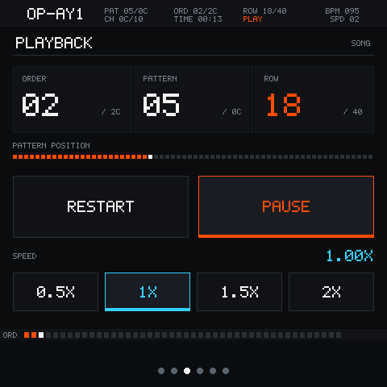
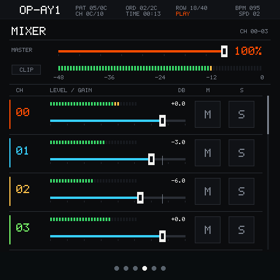
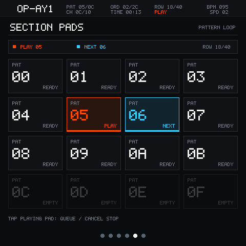
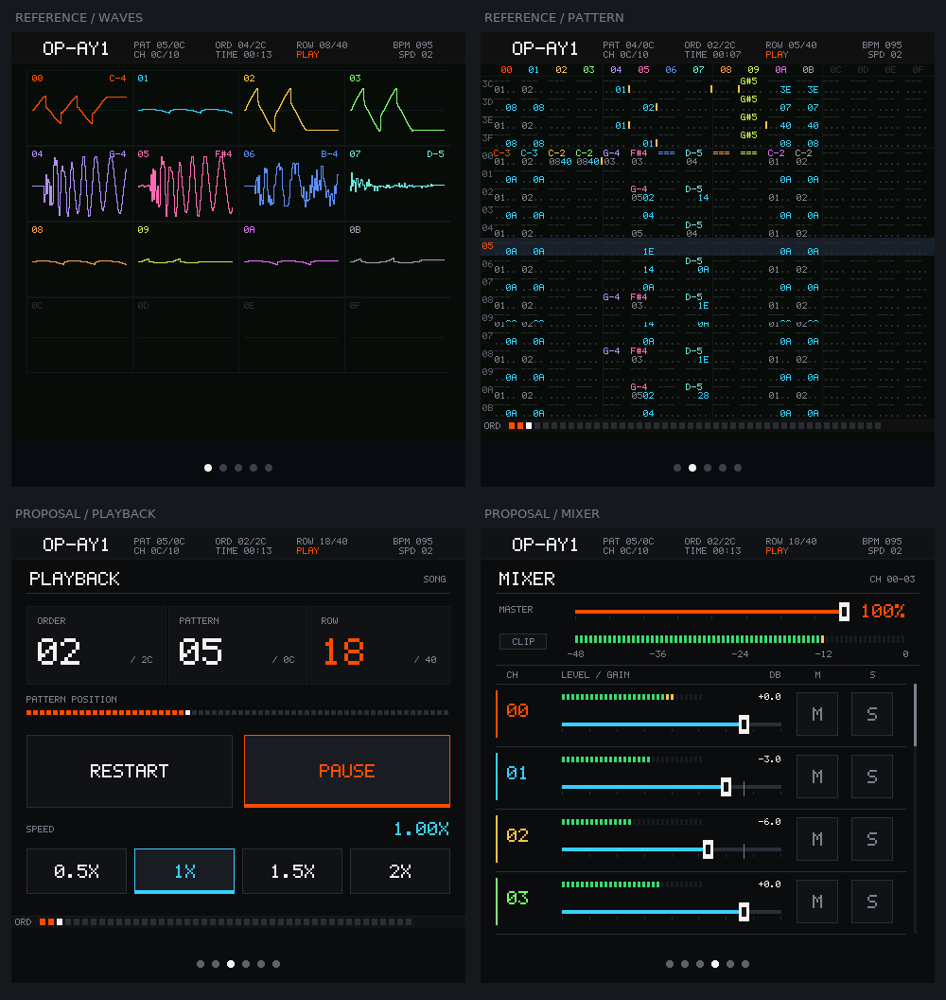

# Playback、调音台和 Section Pads 视觉方案

日期：2026-10-26。状态：设计已由用户确认并完成实现。
实际原生模拟器截图及回归结果见 [验证记录](implementation-validation.zh-CN.md)。

用户已认可合成器页面的风格，本次增加 Playback、调音台、序列 Pad 的重新设计，
要求靠近现有第 1 页 WAVES 和第 2 页 PATTERN。合成器已确认的键盘和分组参数布局保留。

## 共同视觉基线

- 直接复用 `tracker_font_data.h` 的 5×7 字形，普通字 1×、标题和关键控件 2×。
- 复用首两页的 32px 顶部状态栏：OP-AY1、PAT、ORD、ROW、CH、TIME、BPM、SPD。
- 黑底、深灰区域、1px 分隔、直角框；减少大圆角卡片和白色圆滑块。
- 播放/当前片段用橙色，选中参数/下一片段用青色，普通文字白色、辅助信息灰色。
- 通道编号使用首两页相同的通道色；电平表仍用绿/黄/红表达 dBFS 区间。
- 保留 480×480。底部导航按合成器接入后的六页展示；导航顺序仍为
  WAVES / PATTERN / PLAYBACK / MIX / SECTION PADS / SYNTH。
- 像素外观不缩小触摸命中区：主操作和 M/S 至少约 44px 高；推子细线背后保留较大拖动区。

## Playback

- 状态栏下方显示 ORDER / PATTERN / ROW，数值使用 tracker 的十六进制表达。
- 行位置条只读，表示当前 Pattern 的 64 行进度，不暗示拖动定位能力。
- 保留 RESTART 和 PLAY/PAUSE 两项真实操作。RESTART 仍然暂停并回到歌曲起点，
  PLAY 从暂停恢复时退出 Pad 循环并开始歌曲播放。
- 移除当前不能使用的 REC 占位，给两项主要操作更大触摸空间；不增加录音功能。
- 保留 0.5× / 1× / 1.5× / 2× 四档速度和实时倍率读数。
- 底部 ORD 小条与第 2 页保持相同表达；BPM/SPD 继续作为状态读数。
- 暂停状态见 [playback-paused.png](images/ui-redesign/playback-paused.png)：
  播放键变为 PLAY，位置保留，顶部状态为 PAUSE。

## 调音台

- 上方固定 MASTER 百分比音量、矩形推子、分段峰值表和 CLIP。
  百分比表示 codec 音量，不标成主输出 dB。
- 下方仍是四行通道滚动列表，每行包含通道编号/颜色、细电平、gain dB、横向推子和 M/S。
- 拟使用 66px 行高，四行完整放入 y=164…428；右边保留滚动指示和拖动区域。
  更新虚拟槽、视口、吸附计算与触摸范围时需保持同一几何定义。
- 每个 M/S 为 44×46px；通道推子可触摸高度保持约 44px。
- 通道 gain 仍为 0…120，100=0dB、120=+6dB、50=-15dB、0=静音。
- 电平表仍为 -48…0dBFS，绿区到 -12，黄区到 -3，红区接近 0。
  通道颜色只用于识别，不替代电平的区间含义。
- 保留现有 mute/solo 规则和滚动/推子/翻页的手势优先级；空通道灰暗且不可调。
- Solo 示例见 [mixer-solo.png](images/ui-redesign/mixer-solo.png)：
  01 的 S 亮青色，其他通道的 M 亮橙色且贡献电平归零。
- 合成器接入后，主电平读取最终数字总线；通道区继续表示各 tracker 通道。

## Section Pads

- 保留 4×4 Pattern Launcher。页面增加 PLAY / NEXT / ROW 的只读状态摘要。
- 普通 Pad 为深灰直角框，运行 Pad 橙色，下一片段青色；文字同时显示 PLAY/NEXT，
  不仅靠颜色区分状态。空位显示 EMPTY，保持不可触发。
- 点击普通 Pad 启动/排队；点击运行 Pad 排队停止，再点取消。切换和停止仍在 Pattern 边界生效。
- 排队切换和待停止仍随节奏闪烁。静态设计图展示闪烁亮相，不代表持续点亮。
- 待停止状态见 [pads-stop.png](images/ui-redesign/pads-stop.png)：
  状态条显示 STOP QUEUED，运行 Pad 标为 STOP，取消下一片段的排队提示。
- 该页没有步进编辑、拖动排序、录制或 Chain 功能；视觉重设计保持现有片段启动含义。

## 参考与后续实施

以上为静态设计稿，使用与应用相同的像素字体和调色板生成。
不会把 PNG 当成运行界面。正式实现复用公共 C 绘制逻辑和 GSP 输入，
同步生成资源、状态更新、命中范围与导航。

新三页布局已经并入 [合成器实施计划](synthesizer-plan.zh-CN.md) 的 UI 阶段：
先补共用逻辑的 host backend，再验证播放/重启/速度、推子/M/S/滚动、
Pad 的启动/排队/待停止/取消，以及跨页导航。模拟器通过后再做对应设备检查。

本文件中的提案 PNG 保留为设计基线；实际运行证据与设备验证边界以验证记录为准。
